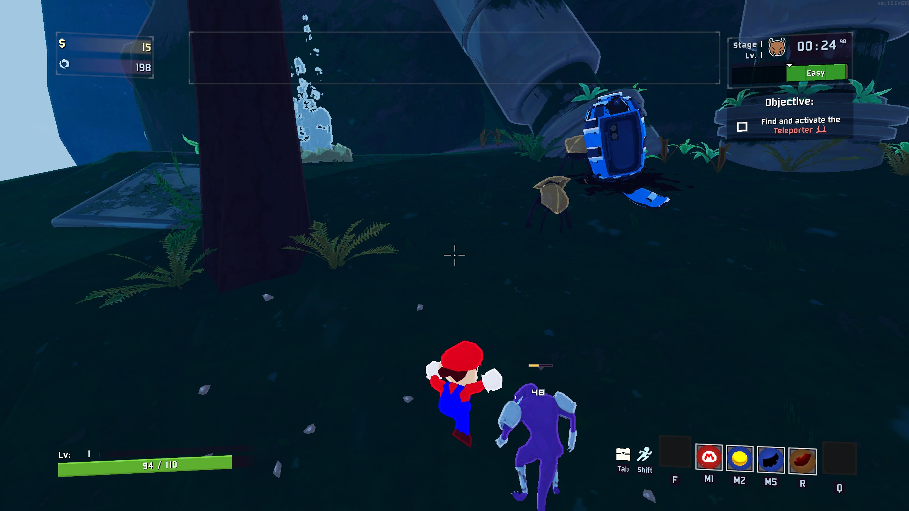

# Mario 64 Survivor

**One-click install on Melty: https://melty.gg/m/mario-64-survivor**



Play Risk of Rain 2 as Super Mario 64's real Mario. You get his whole SM64 moveset, his voice and sounds, and his model, all read from your own Super Mario 64 ROM. Risk of Rain 2's items power up his punches, kicks and stomps.

## What you get

- **Mario as a new survivor.** He's on the character select screen, idling live as in SM64.
- **His real Super Mario 64 movement**, run by libsm64: triple jumps, long jumps, backflips, side flips, wall kicks, dives, slides and ground pounds, on every Risk of Rain 2 stage.
- **SM64 attacks deal Risk of Rain 2 damage:**

  | Attack | Damage |
  |---|---|
  | Punch-punch-kick combo | 240% |
  | Jump kick | 300% |
  | Dive | 300% |
  | Slide kick | 350% |
  | Stomp on an enemy's head (he bounces off) | 400% |
  | Ground pound (hits everything around where he lands) | 600% |

- **Items work.** Damage items raise every hit, and on-hit items (Ukulele, Sticky Bomb, Tri-Tip and the rest) trigger from Mario's attacks. Health, armor, healing and regen work as for any survivor.
- **Big hits knock Mario back**, SM64-style.
- **Single player.**

## Controls

| SM64 button | Risk of Rain 2 input (default key) |
|---|---|
| Stick | Move (WASD) |
| A: jump | Jump (Space) |
| B: punch / kick / dive | Primary skill (left mouse) |
| Z: crouch / ground pound | Secondary or utility skill (right mouse or Shift) |

## Requirements

- Risk of Rain 2 (Steam).
- Your own Super Mario 64 (US) ROM. Nothing from SM64 is included.
- Melty installs everything else: BepInEx 5, and libsm64, which it builds on your PC from the SM64 decompilation.

## Installing without Melty

Melty does all of this for you. To install by hand:

1. Install [BepInEx 5](https://github.com/BepInEx/BepInEx/releases) (5.4.23 or later, x64) into Risk of Rain 2.
2. Download `MarioRoR2-<version>.zip` from [Releases](../../releases) and unzip it into the game folder. It puts `MarioRoR2.dll` in `BepInEx/plugins/MarioRoR2`.
3. Build [libsm64](https://github.com/libsm64/libsm64) yourself (commit `fd11813`, run `make` under MSYS2 MinGW64). Copy `dist/sm64.dll` and the MinGW runtime DLLs it needs (such as `libwinpthread-1.dll`) to `BepInEx/MarioRoR2-native`. The release doesn't include `sm64.dll` because it is built from the SM64 decompilation.
4. Put your Super Mario 64 (US) ROM (`.z64`, `.v64` or `.n64`) in Downloads, Desktop or Documents. The mod finds it at start. If it's somewhere else, set `RomPath` in `BepInEx/config/gg.melty.marioror2.cfg`.
## How it works

- A BepInEx plugin adds a survivor cloned from Commando's body, so Mario keeps Commando's hurtboxes, item displays and networking. Commando's model is hidden and his physics switched off.
- libsm64 (`sm64.dll`) runs Mario at 30 ticks a second from RoR2's inputs, and the body follows him.
- The stage's world colliders are turned into SM64 collision in 32 m chunks around Mario.
- Mario's mesh comes from libsm64 every tick and is drawn with RoR2's own lit shader. His texture is the ROM's, baked per colour.
- RoR2 ships with Unity's audio switched off, so Mario's sound, mixed by libsm64 from the ROM, plays through Windows' waveOut.

The design lives in `sheets/*.json` (survivor, controls, skills, attacks, tuning, game hooks). `tools/sheets.py` preflights the sheets and generates `src/Generated/Sheets.g.cs` on every build.

## Building

```bash
dotnet build -c Release
```

This needs the .NET SDK, Python 3, and Risk of Rain 2 with BepInEx at `RoR2Dir` (set in `MarioRoR2.csproj`).

## Credits

- **libsm64** by jaburns and contributors (CC0). It builds on the n64decomp Super Mario 64 decompilation.
- **Risk of Rain 2** by Hopoo Games / Gearbox. **Super Mario 64** by Nintendo. Both are read from the player's own copies; none of their files ship with this mod.
- Built with Claude Code (AI-assisted), using the universal-modder toolkit.

## License

MIT for this mod's own code (see LICENSE). Remixes are welcome.
